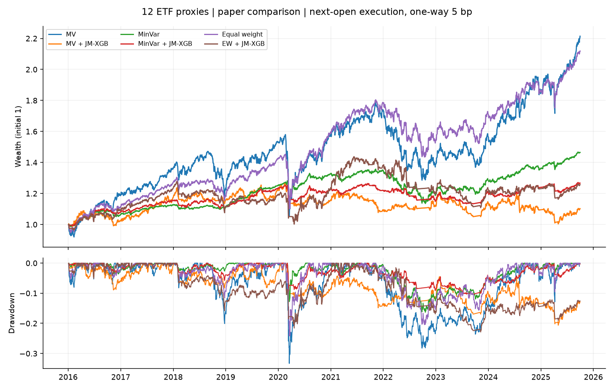
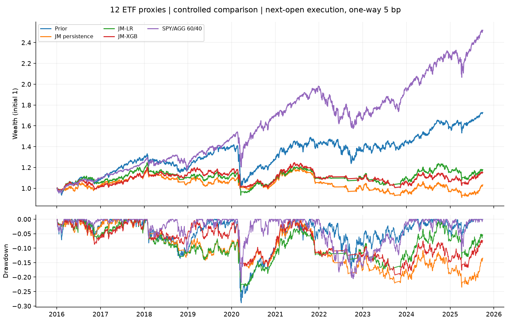
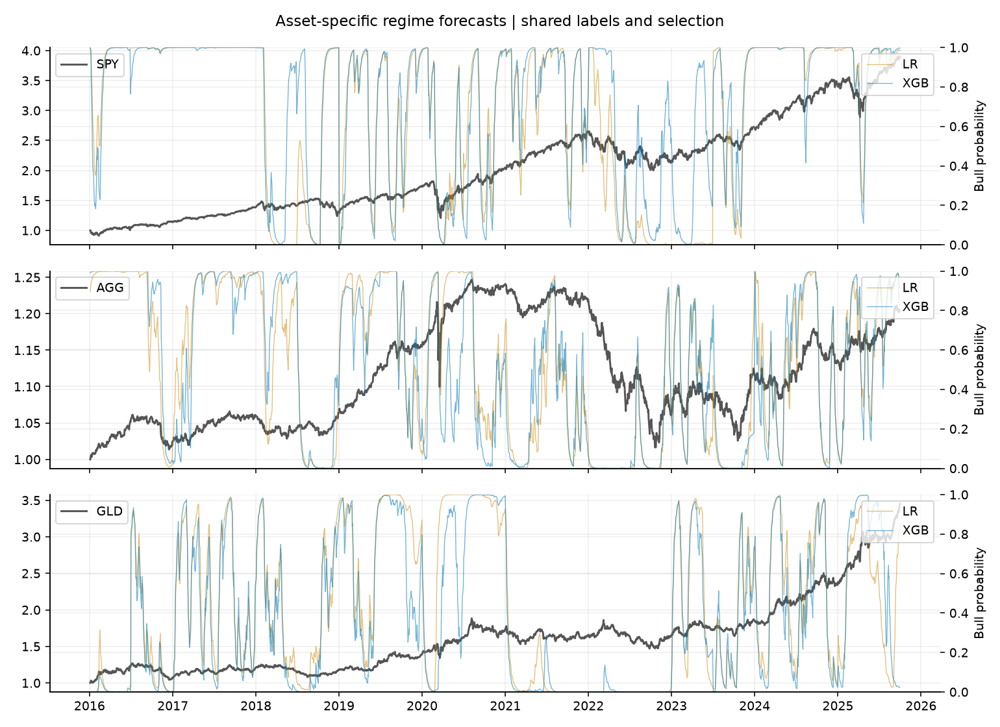

# 국면 예측을 활용한 글로벌 ETF 자산배분

> **국내 실험 진행 중:** [한국 시장 설계와 실행 방법](docs/korea-design.md). 11년 학습·5년 검증을 유지하며, 아래 표는 기존 글로벌 ETF 연구 결과다. 국내 성과는 원자료 수집과 독립 검증이 끝난 뒤 별도로 생성한다.

**12개 자산군으로 다시 구성한 Jump Model–XGBoost ETF 응용 연구.**

[](https://github.com/bucheoncityboy/global-etf-regime-allocation/actions/workflows/ci.yml)

`실제 ETF 12개 + BIL` · `일별 판단·다음 시가 체결` · `편도 5bp` · `117개월 주 실험` · `TypeScript + Python 수치 라이브러리`

Shu·Yu·Mulvey의 자산별 국면 예측을 공개 ETF에 적용했다. **논문형 배분의 개선**과 **동일 조건에서 XGBoost의 추가 가치**를 분리해 평가한다. 기존 저장소의 결과를 이식하지 않고 새 입력·프로토콜·계정으로 계산했다.

> **연구 범위** — 원문의 1991–2023년 12개 지수가 아닌 ETF 대용 자료다. 주 실험은 5년 학습·3년 검증이며 원문의 11년·5년과 다르다. 과거 결과를 확인한 뒤 설계한 후속 연구로, 전향적으로 확보한 미사용 표본은 아니다.

[핵심 결과](#핵심-결과) · [논문과의 비교](#논문과의-비교) · [국면과 ML 비교](#국면과-ml-비교) · [실험 설계](#실험-설계) · [데이터 명세](#데이터-명세) · [검증 방법론](#검증-방법론) · [결론](#결론) · [재현](#재현)

## 핵심 결과

- **전체 배분:** 논문형 JM–XGBoost의 샤프가 기본 배분보다 높은 경우는 세 배분 중 **0개**다.
- **분류기 비교:** 같은 국면·입력·평균 추정·배분·비용에서 로지스틱 샤프 **0.009**, XGBoost **-0.018**다.
- **불확실성:** 연 CER 차이(XGB−LR) -0.16%p, 95% 구간 [-2.64, +2.13]%p. 구간이 0을 포함하므로 XGBoost의 우위를 확인하지 못했다.

## 논문과의 비교

원문은 2007–2023년, 아래 ETF 적용은 **2016.01.04–2025.09.30**이다. 원문과의 수치 차이는 자료·기간·학습창이 함께 달라 원인별 인과효과로 해석할 수 없다.

| 배분 | 원문 샤프 기본 → 국면 | ETF 샤프 기본 → 국면 | ETF 최대낙폭 기본 → 국면 |
| --- | --- | --- | --- |
| 평균분산 | 0.37 → 1.02 | 0.504 → -0.077 | -33.32% → -20.65% |
| 최소분산 | 0.70 → 1.12 | 0.368 → 0.121 | -16.34% → -10.34% |
| 동일가중 | 0.51 → 0.91 | 0.575 → 0.087 | -24.17% → -22.89% |

이 비교는 예측·조건부 평균·위험회피·거래벌점·현금 규칙을 함께 바꾼다. XGBoost 단독 효과는 다음 절에서 비교한다. [원문 §4–5·표6](https://arxiv.org/html/2406.09578v2#S5.SS2) · [구현 대응표](docs/paper-comparison.md)



<details>
<summary>개별 ETF 0/1 전략 · 비용 차감 성과</summary>

| ETF | B&H 샤프 | JM 유지 샤프 | JM–XGB 샤프 | JM–XGB 최대낙폭 |
| --- | --- | --- | --- | --- |
| SPY | 0.755 | 0.300 | 0.343 | -26.42% |
| IJH | 0.503 | 0.055 | 0.018 | -39.70% |
| IWM | 0.435 | 0.123 | 0.403 | -28.22% |
| EFA | 0.424 | 0.383 | -0.022 | -20.30% |
| EEM | 0.378 | 0.251 | 0.226 | -25.28% |
| AGG | 0.013 | -0.239 | -0.269 | -10.01% |
| TLT | -0.093 | -0.219 | -0.414 | -27.30% |
| HYG | 0.441 | -0.160 | 0.012 | -22.00% |
| LQD | 0.179 | 0.091 | -0.259 | -14.76% |
| IYR | 0.286 | -0.305 | -0.470 | -44.88% |
| DBC | 0.356 | 0.397 | 0.160 | -35.73% |
| GLD | 0.816 | 0.310 | 0.426 | -14.04% |

JM 유지는 XGBoost가 선택한 벌점을 공유하고, 당일 온라인 국면을 다음 날로 유지한다. XGB만 추가 시장 피처와 확률 평활을 사용하므로 공정한 분류기 비교는 아니다. ETF 수를 독립 통계 표본 수로 취급하지 않는다. [전체 CSV](results/individual.csv)

</details>

## 국면과 ML 비교

두 국면은 자산마다 따로 추정한다. 아래 네 모델은 **동일한 JM 라벨, 벌점 선택 경로, 평활 반감기 4일, 조건부 평균, 공분산, 제약·비용**을 공유한다. 빈도 기준과 JM 유지는 분류기를 학습하지 않으며, LR·XGB는 같은 13개 입력을 받는다. 벌점은 직전 검증창의 LR·XGB 순초과 샤프 평균으로 선택했다.

| 모델 | CAGR | 샤프 | 최대낙폭 | 연 CER(γ=5) | 연 비용 | 평균 위험비중 |
| --- | --- | --- | --- | --- | --- | --- |
| 빈도 기준 | 5.78% | 0.374 | -28.93% | 2.96% | 0.14% | 88.54% |
| JM 유지 | 0.32% | -0.154 | -23.53% | -1.10% | 1.79% | 73.37% |
| JM–로지스틱 | 1.70% | 0.009 | -25.06% | 0.21% | 1.37% | 72.93% |
| JM–XGBoost | 1.48% | -0.018 | -19.27% | 0.05% | 1.58% | 74.80% |

연 CER 차이(XGB−LR) -0.16%p, 95% 구간 [-2.64, +2.13]%p. 구간이 0을 포함하므로 XGBoost의 우위를 확인하지 못했다. 같은 날짜를 함께 뽑는 21일 원형 블록 부트스트랩 2,000회 결과다. 63일 블록·다른 창의 결과도 공개한다. 전략 선택과 모델 학습을 다시 수행한 불확실성은 포함하지 않는다.





### 학습창과 평가기간

| 학습/검증 | 평가 구간 | 거래일 | LR 샤프 | XGB 샤프 | XGB−LR 연 CER |
| --- | --- | --- | --- | --- | --- |
| 5년/3년 | 전체 | 2450 | 0.009 | -0.018 | -0.16%p |
| 5년/3년 | 공통 2024.01–2025.09 | 438 | -0.088 | 0.010 | +1.08%p |
| 7년/3년 | 전체 | 1947 | 0.153 | 0.178 | +0.32%p |
| 7년/3년 | 공통 2024.01–2025.09 | 438 | -0.210 | -0.520 | -3.29%p |
| 11년/5년 | 전체 | 438 | -0.065 | -0.120 | -0.26%p |
| 11년/5년 | 공통 2024.01–2025.09 | 438 | -0.065 | -0.120 | -0.26%p |

전체 구간 비교에는 시장 시기 차이가 섞인다. 공통 21개월 비교는 동일한 시장 구간에서 학습·검증창을 함께 바꾼 민감도다. 원문 창의 표본이 짧아 장기 성과를 대변하지 못한다.

### 거래비용 민감도

| 편도 bp | LR 샤프 | XGB 샤프 | XGB−LR 연 CER |
| --- | --- | --- | --- |
| 0 | 0.231 | 0.200 | -0.27%p |
| 5 | 0.009 | -0.018 | -0.16%p |
| 10 | -0.032 | -0.126 | -0.65%p |
| 25 | -0.063 | -0.018 | +0.37%p |

벌점과 평활은 5bp에서 선택한 경로로 고정하고, 비용별 거래벌점·실제 체결비용을 함께 바꿔 재최적화했다.

[전체 성과](results/summary.csv) · [신뢰구간](results/paired_intervals.csv) · [온라인 JM 라벨 대비 예측 지표](results/forecast_quality.csv) · [기대수익 예측 IC](results/return_forecast_ic.csv)

### 결과가 달라지는 지점

주 실험에서 XGBoost의 온라인 JM 라벨 대비 균형정확도는 **82.31%**, 로지스틱은 **84.05%**다. 이 라벨은 경제 상태의 정답이 아니며 높은 분류 정확도가 수익 예측력으로 이어진다고 볼 수 없다.

통제 경로의 XGB 국면 평균 예측과 다음 날 종가 기준 초과수익의 상관이 양수인 자산은 **1/12개**, 자산별 상관의 단순 평균은 **-1.49%**다. XGB의 양방향 연 회전율은 **31.49배**, 연 비용은 **1.58%**다. 이 표본에서는 기대수익 예측의 약함과 잦은 거래가 함께 관측된다. 자료·학습창·기간이 함께 달라 원문과의 차이를 하나의 원인으로 확정하지 않는다. 이 진단은 결과를 본 뒤 추가한 설명용 분석이다.

## 실험 설계

| 항목 | 고정 규칙 |
| --- | --- |
| 주 실험 | 5년 학습 / 3년 순차 검증 / 2016.01–2025.09, 117개월 |
| 추가 창 | 7년/3년, 93개월 · 11년/5년, 21개월 |
| 재학습 | 매년 1·7월 첫 거래일 직전 종가, 6개월 유지 |
| 라벨 | 자산별 2상태 JM, 누적 초과수익 높은 상태가 강세 |
| 예측 | 당일 피처 → 다음 거래일 라벨; 마지막 학습 목표일 ≤ 재학습일 |
| 벌점 후보 | 0, 0.1, 1, 10, 100; JM 초기화 10회 |
| 논문형 선택 | XGB 0/1 순초과 샤프 최대; 첫 검증창에서 평활 0/2/4/8일 선택 후 고정 |
| 통제 비교 선택 | LR·XGB 검증 샤프 평균 최대; 평활 4일 고정 |
| 배분 | 롱온리·차입 없음·개별 위험자산 ≤40%; 강세 자산 ≤3개면 전액 BIL |
| 비교 모델 | 빈도 기준·JM 유지·로지스틱·XGBoost; 추가 BIL·SPY/AGG 60/40 |

[상세 수식·선택 및 실행 시점](docs/methodology.md) · [설계 파일](configs/protocol.json)

## 데이터 명세

SPY·IJH·IWM·EFA·EEM·AGG·TLT·HYG·LQD·IYR·DBC·GLD와 현금 BIL을 사용한다. 장기국채 TLT와 회사채 LQD는 원문 부록 ETF와 다른 대용 자산이다. 지수와 ETF의 만기 구성·비용·담보수익 차이가 남는다.

성과는 USD 기준이다. 가격은 Yahoo 일별 배당조정 종가와 동일 조정계수의 시가, 시장 피처는 FRED DGS2·T10Y2Y·VIXCLS·DGS3MO다. 날짜만 있는 FRED 값은 관측일보다 늦은 거래일에 사용한다. 시장 상관은 **SPY–AGG 252거래일**이다. 미래 빈티지가 완전히 보존된 실시간 데이터는 아니다.

2026-10-20에 받은 입력 중 **2025-09-30까지**만 사용했다. 원본 ZIP·개별 응답 URL·SHA-256을 보관해 재다운로드 없이 재계산할 수 있다. [자산 대응·출처·가격 검증](docs/data.md) · [입력 명세](data/manifest.json)

## 검증 방법론

모든 학습과 스케일링은 재학습일 이전에 끝난다. 검증도 이전 모델의 순차 예측만 사용한다. 예측일 다음 시가에 체결하며 기존 보유분의 밤사이 수익은 기존 자산에 귀속한다. 매수·매도와 BIL 거래를 모두 포함해 자기금융 조건으로 비용을 정산한다.

단위 검증은 비용·체결 시점·평활 인과성·공분산·12자산 제약을 확인한다. 산출물 검증은 모든 계정의 목표 비중을 별도 수량 기반 엔진으로 재생해 NAV·거래량·비용을 대조한다. 학습 목표일, 온라인 JM의 미래 경로 독립성, 모델 간 공유 조건, 원본·소스·출력 해시도 검사한다. [검증 결과](results/verification.json)

## 결론

12개 자산군과 실효성 있는 학습창으로 기존의 짧은 표본·자산 구성 문제를 줄였다. **구간이 0을 포함하므로 XGBoost의 우위를 확인하지 못했다.** 논문의 전체 시스템 개선은 XGBoost가 다른 분류기보다 항상 우수하다는 증거와 다르다. 다음 검증은 이번 결과를 보지 않은 미래 구간 또는 원문 지수 데이터에서 수행해야 한다.

## 재현

Node.js 22 이상과 uv가 필요하다. TypeScript가 실행·프로토콜·작업 분배·해시를 관리하고 잠긴 Python 3.12 수치 라이브러리가 JM·LR·XGB·최적화·그래프를 계산한다.

```powershell
npm ci
uv sync --frozen
npm run typecheck
npx tsx src/harness.ts
npm run reproduce
```

저장된 결과의 무결성과 거래 재생만 확인하려면 `npm run study -- restore` 뒤 `npm run verify`를 실행한다. 전체 재학습은 744개 자산·반기 작업, 3,720개 JM과 최대 7,440개 분류기를 계산한다. `STUDY_WORKERS` 환경변수로 병렬 프로세스 수를 조절한다(기본 4).

[실행 단계·산출물·환경](docs/reproduction.md) · [원문](https://arxiv.org/html/2406.09578v2) · [이전 연구](https://github.com/bucheoncityboy/korean-macro-factor-allocation)
