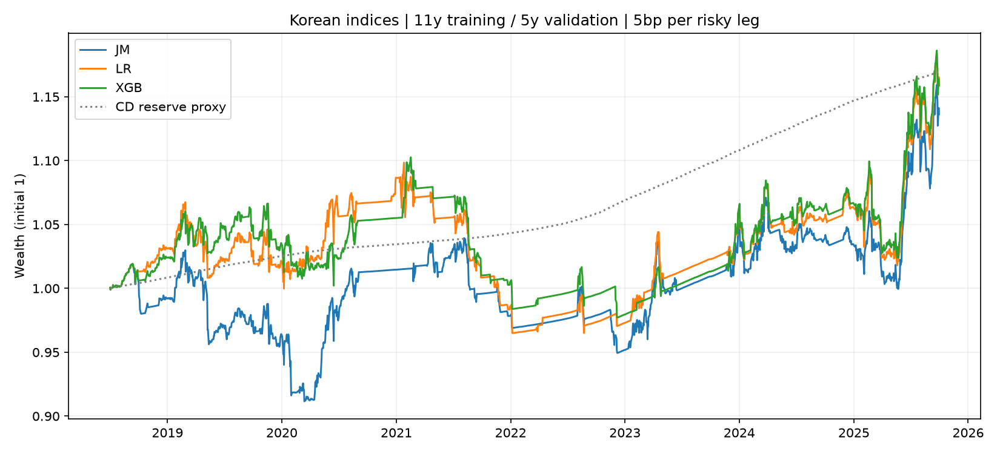

# 한국 시장 · JM–XGBoost 자산배분 실험

## 1. 핵심 결과

XGBoost의 샤프가 로지스틱보다 낮다. 주 비교의 CER 차이 구간이 0을 포함한다.
평가기간은 2018년 7월부터 2025년 9월까지 87개월이다. 주식은 배당을 제외한 가격지수이며, 채권은 관측된 총수익지수다. 미국 원문의 수치 재현이나 실제 ETF 매매성과로 해석하지 않는다.

| 동일 조건 MV | CAGR | 샤프 | 최대낙폭 | 연간 비용 | 연간 회전율 |
| --- | ---: | ---: | ---: | ---: | ---: |
| jm | 1.82% | -0.040 | -11.49% | 0.49% | 9.79 |
| lr | 2.12% | 0.010 | -12.15% | 0.41% | 8.22 |
| xgb | 2.11% | 0.004 | -11.38% | 0.41% | 8.23 |

XGB−LR 연율 CER 차이: **+0.049%p**, 21거래일 블록 재표집 95% 구간 **[-1.914, +2.101]%p**.
CER의 위험회피계수는 5다. 구간은 이미 적합된 예측에 조건부이며, 모형 재학습 불확실성이나 여러 비교에 대한 보정은 포함하지 않는다.



## 2. 논문과 비교

논문형 경로의 편도5bp 비용 차감 결과다. 기본 배분과 JM–XGBoost 국면 배분을 같은 한국 평가기간에서 비교한다.

| 배분 | 기본 샤프 | 국면 샤프 | 기본 최대낙폭 | 국면 최대낙폭 |
| --- | ---: | ---: | ---: | ---: |
| 평균분산 | -0.032 | 0.020 | -18.76% | -9.97% |
| 최소분산 | 0.459 | 0.076 | -1.19% | -1.18% |
| 동일가중 | 0.191 | -0.023 | -11.87% | -8.09% |

이 표는 국면 신호·평균 추정·위험회피·거래 벌점·현금 규칙을 함께 바꾼 전체 전략 비교다. 분류기의 추가 가치는 동일 조건 경로에서 평가한다.

| 항목 | 원문 | 한국 실험 |
| --- | --- | --- |
| 학습·검증·재학습 | 11년·5년·반기 | 동일 |
| 평가 | 2007–2023, 204개월 | 2018.07–2025.09, 87개월 |
| 자산 | 미국 중심 12개 지수 | 국내 주식 2·채권 만기구간 5·달러 현물 1 |
| 주식 수익률 | 총수익/순총수익 | 배당 미포함 가격수익 |
| 시장 변수 | 미국 금리·VIX·주식/채권 상관 | 한국 3년 금리·10−3년 스프레드·미국 VIX·국내 주식/채권 상관 |
| 현금 | DGS3MO 기반 | 전일 이전 CD91일 금리/252 계정 |
| 현금 전환 | 상승 국면 ≤3/12 | 상승 국면 ≤2/8 |
| 거래비용·상한 | 편도5bp·40% | 동일, 현금 계정 거래비용 0 |
| λ·평활 | 원문 λ 그리드 개수 미공개 | λ 8개, 초기 h∈{0,2,4,8} 선택 후 고정 |

채권 다섯 개는 혼합 채권시장의 만기 구간이다. 국채·은행채·회사채를 각각 보유하는 구성으로 부르지 않는다. 금리 하락·상승에 대한 공통 노출이 크므로 자산 수가 독립적인 위험요인 수를 뜻하지 않는다.

원문 경로는 XGB의 과거 검증 성과로 λ와 초기 평활을 선택한다. 동일 조건 비교는 LR·XGB 검증 샤프의 평균으로 공통 λ를 선택하며, JM 라벨·평활 h=4·조건부 평균·포트폴리오 규칙을 공유한다. 두 경로는 사전에 고정했으며 결과에 따라 주 실험을 바꾸지 않는다.

## 3. 국면과 ML 비교

| 자산 | JM 예측수익 IC | LR IC | XGB IC |
| --- | ---: | ---: | ---: |
| KOSPI | 0.013 | 0.017 | 0.013 |
| KOSDAQ | 0.011 | 0.005 | -0.007 |
| BondShort | 0.080 | 0.049 | 0.047 |
| Bond1_2 | 0.046 | 0.046 | 0.044 |
| Bond2_3 | 0.034 | 0.021 | 0.027 |
| Bond3_5 | 0.015 | 0.019 | 0.029 |
| Bond5plus | 0.023 | 0.035 | 0.051 |
| USD | -0.028 | 0.001 | -0.020 |

IC는 과거 국면의 조건부 평균으로 만든 당일 예측 초과수익과 실제 초과수익의 자산별 상관이다. 국면 분류 정확도와 구분하며, 국면의 정답은 해당 훈련모형의 온라인 JM 상태로 정의했다.

| 동일 조건 배분 · 5bp | JM 샤프 | LR 샤프 | XGB 샤프 |
| --- | ---: | ---: | ---: |
| 평균분산 | -0.040 | 0.010 | 0.004 |
| 최소분산 | 0.049 | 0.095 | 0.215 |
| 동일가중 | -0.057 | -0.014 | 0.055 |

아래 조건은 사전 지정한 MV 민감도 분석이며, 주 비교는 5bp·추가 지연0·현금 규칙 적용이다.

| MV 조건 | JM 샤프 | LR 샤프 | XGB 샤프 |
| --- | ---: | ---: | ---: |
| 편도 0bp | 0.177 | 0.225 | 0.271 |
| 편도 5bp | -0.040 | 0.010 | 0.004 |
| 편도 10bp | -0.189 | -0.109 | -0.244 |
| 편도 20bp | -0.340 | -0.340 | -0.534 |
| 1거래일 추가 지연 | 0.056 | -0.083 | -0.116 |
| 강제 현금 전환 해제 | 0.082 | 0.143 | -0.040 |

## 4. 실험 설계

2001년 자료는 지표 준비에 사용한다. 최초 학습은 2002.07–2013.06, 순차 검증은 2013.07–2018.06, 평가는 2018.07 이후다. 매년 1·7월에 이전 11년으로 다시 학습하고, 그때까지 존재하는 직전 5년의 순차 예측으로 λ를 선택한다. 최초 학습부터 평가까지의 명목 11년·5년을 줄이지 않았다.

JM은 자산별 2상태·초기화10회다. 분류기는 수익률 피처8개와 시장 피처5개를 사용하며, X[t]에 대한 라벨은 학습 구간 안에 존재하는 JM[t+1]만 허용한다. XGBoost 2.1.4의 깊이6·100트리·학습률0.3과 로지스틱 C=1을 고정했다.

MV·최소분산·동일비중과 현금 기준계정을 비교한다. 국면 MV는 과거 조건부 평균과 하락 평균 −10bp 상한을 사용한다. 공분산은 반감기252일, 기본 MV 평균은1260일이다. 공매도·레버리지는 허용하지 않고 자산별40% 상한을 적용한다.

종가 지수 연구의 신호종가→다음종가 규약을 기본으로 쓰며, 추가1거래일 지연·비용0/10/20bp·현금 전환 해제를 별도 결과로 제공한다. 이는 실제 종가 체결이 가능하다는 가정의 검증을 대신하지 않는다.

## 5. 데이터 명세

| 자산 | 원천 | 종류 |
| --- | --- | --- |
| KOSPI | Naver Finance / KOSPI | price_index |
| KOSDAQ | Naver Finance / KOSDAQ | price_index |
| BondShort | KIS / BC001056 | total_return_index |
| Bond1_2 | KIS / BC001057 | total_return_index |
| Bond2_3 | KIS / BC001058 | total_return_index |
| Bond3_5 | KIS / BC001059 | total_return_index |
| Bond5plus | KIS / BC001060 | total_return_index |
| USD | BOK ECOS / 0000001 | currency_price_no_interest |

전체 거래일은 6,109일이다. 주식 자료의 날짜를 pandas_market_calendars의 XKRX 거래일과 대조했고, 공통 날짜만 남기는 압축이나 가격 보간을 하지 않았다. KIS의 지수 이름·코드를 확인하고 종합지수는 한경/KIS 공개 장기계열과 교차 대조했다.
한경 보조계열에는 일부 비정상 지수값이 있어 원자료로 사용하지 않았다. KIS 자체의 지수값과 별도 발표 일별수익률의 반올림 범위를 검사하며, 보조계열 불일치는 입력 검증 기록에 모두 남긴다.
금리와 VIX는 신호일보다 날짜가 엄격히 앞선 관측치만 사용한다. CD 계정은 모형상 대기자금 수익이며 무위험 증권의 실현 총수익이 아니다. 달러는 원/달러 기준환율 변화만 반영하고 달러 예금이자는 포함하지 않는다.
KIS 지수는 공개된 소수 둘째 자리 수준을 그대로 사용하므로 특히 단기채의 미세한 일별 변동에는 반올림 오차가 있다.

자료: [네이버 금융](https://finance.naver.com/), [KIS 종가지수](https://www.bond.co.kr/conts/10050), [한경·KIS 정의](https://datacenter.hankyung.com/kis-bond), [한국은행 ECOS](https://ecos.bok.or.kr/), [FRED VIX](https://fred.stlouisfed.org/series/VIXCLS).

## 6. 검증 방법론

각 거래의 자금보존 방정식을 다른 수치해법(brentq)으로 다시 풀어 31개 계정·55,273계정일을 재계산했다. NAV 최대 차이는 1.73e-12다. 훈련 라벨·검증 기간·신호 시점·비용·상한을 함께 확인했다.
합성자료 테스트는 미래자료 변경이 최초 예측·벌점 선택을 바꾸지 않는지와 계정 계산 경로를 검사한다. 합성자료는 실제 성과 표에 사용하지 않으며 원자료 응답·코드·입력 해시를 별도로 고정했다.

## 7. 결론

XGBoost의 샤프가 로지스틱보다 낮다. 주 비교의 CER 차이 구간이 0을 포함한다.
한국 표본에서의 결과는 이 자산 구성·수익률 정의·거래 규약에 대한 방법론 적용 결과다. 원문의 통계적 진위나 다른 시장에서의 XGBoost 우위를 직접 판정하지 않는다. 주식 배당 누락, 채권 평가가격·반올림, 채권 구간 사이의 높은 상관과 이상적 지수 체결이 적용 범위를 제한한다.
한국의 개별 모형 성과를 보기 전에 설계를 고정했지만, 미국 ETF 결과를 확인한 뒤 시장을 바꾼 후속 연구다. 전향적 완전 미사용 표본의 확증 실험은 아니다. 연율 수치는252거래일 기준이다.

## 8. 재현

Node22 이상과 uv를 준비하고 저장소 루트에서 실행한다. 최초 자료 수집은 공개 제공자의 속도 제한을 존중하며 중단 후 캐시에서 재개한다. 당시 원 응답은 로컬 data/private/korea/raw에 보관하며 재조회된 값이 같은 바이트일 것을 보장하지 않는다.

```powershell
npm ci
uv sync --frozen
npx tsx src/korea.ts acquire
npx tsx src/korea.ts all
npx tsx src/korea_harness.ts
npx tsx src/korea.ts verify
```

원자료 공급자가 응답·과거값을 바꾸면 기존 source-manifest와 비교해 새 스냅샷으로 취급한다. 결과 파일은 summary.csv, individual.csv, return-ic.csv, bootstrap.json, tuning.json, fits.json, NAV·목표비중·거래원장 parquet 및 verification.json으로 제공한다.
