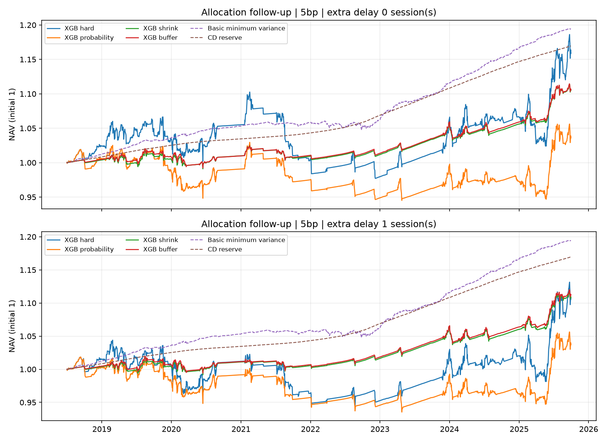

# 한국 JM–XGBoost · 배분 개선 후속 실험

## 1. 핵심 결과

사후 탐색의 주 비교 CER 구간이 0을 포함해 개선을 확정하지 못했다.
기존 평가 성과를 본 뒤 설계한 탐색 연구다. 기존 11년 학습·5년 순차 검증·반기 재학습의 예측을 고정하고 배분만 변경했다. 새로운 미사용 표본이나 원문 재현으로 해석하지 않는다.

**주 비교: 편도5bp·추가1거래일 지연, buffer XGB 대 기존 XGB.**

| XGB 배분 | CAGR | 초과수익 샤프 | 최대낙폭 | 연간 비용 | 평균 현금 |
| --- | ---: | ---: | ---: | ---: | ---: |
| 기존 이산 판단 | 1.43% | -0.116 | -9.65% | 0.41% | 69.0% |
| 확률 가중 | 0.52% | -0.369 | -8.16% | 0.26% | 77.1% |
| 평균 50% 축소 | 1.47% | -0.385 | -2.57% | 0.09% | 93.0% |
| 축소 + 거래 완충 | 1.51% | -0.375 | -2.52% | 0.08% | 93.1% |

주 비교 연율 CER 차이 **+0.615%p**, 21거래일 블록 95% 구간 **[-2.177, +3.316]%p**.
구간은 고정된 예측에 조건부이며 모형 재학습·다중 비교 보정은 포함하지 않는다. 좋은 결과만 선택하지 않고 네 단계를 모두 공개한다.

## 2. 단순 전략과 비교

| 추가 지연 | 기본 MV | 기본 최소분산 | 기본 동일가중 | buffer LR | buffer XGB |
| --- | ---: | ---: | ---: | ---: | ---: |
| 0거래일 | -0.032 | 0.459 | 0.191 | -0.143 | -0.420 |
| 1거래일 | -0.001 | 0.457 | 0.210 | -0.171 | -0.375 |

값은 비용 차감 후 현금 대비 샤프다. 기본 배분과 국면 배분의 위험회피·거래 벌점·현금 규칙은 다르므로 전체 전략의 비교다. 분류기 비교는 같은 단계의 LR와 XGB로 확인한다.

## 3. 국면과 ML 비교

| 배분 단계 | 지연0 LR | 지연0 XGB | 지연1 LR | 지연1 XGB |
| --- | ---: | ---: | ---: | ---: |
| 기존 이산 판단 | 0.010 | 0.004 | -0.083 | -0.116 |
| 확률 가중 | -0.347 | -0.374 | -0.361 | -0.369 |
| 평균 50% 축소 | -0.146 | -0.411 | -0.137 | -0.385 |
| 축소 + 거래 완충 | -0.143 | -0.420 | -0.171 | -0.375 |

| 지연1 · 연율 CER 차이 | 점추정 %p | 21일 블록 95% 구간 %p |
| --- | ---: | ---: |
| 확률 가중 − 기존 | -0.680 | [-2.055, +0.770] |
| 평균 축소 − 확률 가중 | +1.248 | [-0.710, +3.086] |
| 거래 완충 − 평균 축소 | +0.048 | [-0.069, +0.152] |
| buffer XGB − buffer LR | -0.332 | [-1.062, +0.317] |
| buffer XGB − 기본 최소분산 | -1.067 | [-2.513, +0.301] |

확률·국면별 평균·선택된 λ·평활 h=4는 기존 예측과 같다. 새 학습이나 확률 보정, XGB 규제 탐색을 실행한 결과가 아니다. 자산별 기대수익 IC는 return-ic.csv에 제공한다.

## 4. 실험 설계

평가는 2018.07.02–2025.09.30, 87개월·1,783거래일이다. 두 분류기·네 배분 단계·두 지연 조건의16계정과 기본 MV·최소분산·동일가중·현금의8계정을 합해24계정이다.

확률 가중은 p0×mu0+(1−p0)×min(mu1,−0.001)이다. 기존 하락 평균 상한을 유지해 확률 사용의 효과와 혼합하지 않는다. 다음 단계에서 기대수익을50%로 축소하고, 마지막에 제안된 위험자산 편도 비중 변화 합이2% 미만이면 현재 평가액의 비중을 유지한다.

상승 국면2개 이하일 때 전체 현금 전환과 자산별40% 한도 위반 교정은 거래 완충보다 우선한다. 공분산·위험회피계수·거래 벌점은 기존 방식과 같다. 0.5와2%는 실행 전에 한 값씩 고정했으며 최고 성과로 선택하지 않았다.

추가 지연1은 두 거래일 전까지의 신호·평균·공분산을 사용한다. 실행 직전 실제 보유 비중으로 비용과 거래를 계산한다. 지연 계정은 첫 평가일에 현금으로 시작한다. [고정 설계](../../docs/korea-improvement-design.md)와 [설정](../../configs/korea-improvement.json)을 참고한다.

## 5. 데이터 명세

기존 국내 주식2개·KIS 혼합채권 만기구간5개·달러 현물1개와 CD 모형 계정을 그대로 사용한다. 자료를 보간하거나 신규 자료로 바꾸지 않았다. 주식 배당과 달러 이자는 제외하며, 현금은 CD91일 금리/252로 계산한 계정이다.

[기존 자료 명세](../korea/README.md) · [입력 해시와 실행 전 고정](design-freeze.json). 기존 예측 및 원장의 해시도 고정했다. 평가기간 성과를 이미 확인했으므로 사후 실험이라는 한계가 있다.

## 6. 검증 방법론

독립 brentq 정산 재계산: 24계정·42,792계정일, NAV 최대 오차 2.49e-13.
기존 원장과의 일치: 8계정, NAV 최대 오차 0.

샤프·CAGR·수수료·회전율은 일별 원장에서 다시 계산한다. 미래 자료를 변경해도 최초 비중이 같아야 하며, 거래 완충은 실제 보유 비중을 유지해야 한다. 강제 현금 전환·한도 교정 예외와 합성자료의 금융 검증 거부를 검사한다.

실제 수익률로 정산을 재검증하려면 비공개 로컬 준비 패널이 필요하다. CI는 합성 거래·시점 검사, 공개 산출물 해시,24계정 성과 재계산과 기존8계정 일치를 검사한다.

## 7. 결론

사후 탐색의 주 비교 CER 구간이 0을 포함해 개선을 확정하지 못했다.
추가 지연1에서 XGB 샤프는 기존 -0.116에서 지정한 최종 단계 -0.375로 변했다. 같은 최종 단계의 LR 샤프는 -0.171, 기본 최소분산은 0.457다.
한 단계의 성과나 한 분류기의 상대 우위를 다른 표본으로 일반화하지 않는다. 이 실험은 이미 본 자료에서 배분 규칙의 효과를 살피며, 신규 자료의 확증이나 ETF 실거래 성과 검증을 대신하지 않는다.

## 8. 재현

Node22 이상과 uv의 고정 라이브러리를 사용한다. 원자료·준비 패널·계정 캐시는 data/private에 보관하며 공개하지 않는다.

~~~powershell
npm ci
uv sync --frozen
node --import tsx src/korea_improve_harness.ts
node --import tsx src/korea_improve.ts run
node --import tsx src/korea_improve.ts verify
node --import tsx src/korea_improve.ts verify-public
~~~

최초 실행 전에 freeze 명령으로 설계를 고정했다. 기존 고정 기록은 덮어쓰지 않는다. summary.csv·years.csv·contributions.csv·return-ic.csv·bootstrap.json과 NAV·비중·거래 parquet를 함께 공개한다. 연율은252거래일 기준이며 연도별 표의2018·2025년은 부분 연도다.
